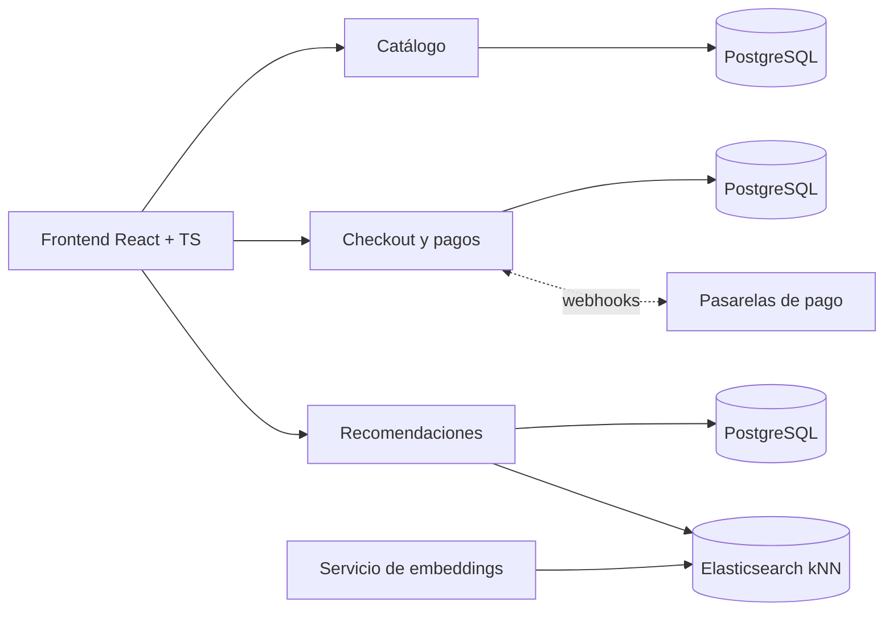

# CompraPues · Decisiones de arquitectura

Documentación de las decisiones técnicas detrás de **CompraPues**, un marketplace multitienda en producción ([comprapues.com.py](https://comprapues.com.py)), construido en equipo con el cliente.

> **Aviso:** este repositorio **no contiene el código del cliente**. Los fragmentos de `snippets/` son ejemplos ilustrativos y genéricos de los patrones usados (modelos y nombres simplificados). El objetivo es explicar el razonamiento de ingeniería, no publicar el producto.

**Stack:** Python · Django REST Framework · FastAPI · PostgreSQL (RLS) · Elasticsearch (kNN) · Redis · React + TypeScript · Docker · GitHub Actions · Sentry

---

## Contexto

- Marketplace multitienda con **11 microservicios**, cada uno con su propia base PostgreSQL y Row Level Security.
- Pagos con webhooks de varias pasarelas (Bancard, Pagopar, Dinelco): verificación de firma, reintentos e idempotencia.
- Recomendaciones personalizadas ("Para ti") basadas en embeddings de productos.
- Rol: diseño, desarrollo, pruebas, despliegue, monitoreo y resolución de incidentes (ciclo completo).

Métricas de frontend: FCP 1,7 s · TBT 0 ms.
<!-- COMPLETAR si tienes datos reales: tiendas activas, pedidos procesados, usuarios -->

## Arquitectura (simplificada)

Se muestran solo los servicios relevantes para las decisiones de abajo. Ver [docs/architecture.md](docs/architecture.md).

## Decisiones y trade-offs

### 1. Aislar búsqueda y recomendaciones del catálogo y del checkout

- **Problema:** generar vectores y ejecutar búsquedas kNN consume mucha CPU y memoria; no debía degradar la compra.
- **Decisión:** Elasticsearch y un servicio de embeddings en su propio stack, separados del catálogo y del checkout.
- **Trade-off:** el índice puede desfasarse del catálogo y hay más piezas que operar.
- **Mitigación:**
  - Degradación elegante: si Elasticsearch falla, la sección "Para ti" se oculta y el checkout no se ve afectado → [`snippets/graceful_degradation.py`](snippets/graceful_degradation.py).
  - Endpoint `/diagnostics` que informa cuántos productos tienen embedding.
  - Comando de gestión para recalcular los embeddings pendientes.

### 2. Recomendaciones: una sola búsqueda kNN

- **Problema:** calcular el vector de interés con las últimas 20 interacciones implicaba pedir 20 embeddings a Elasticsearch.
- **Decisión:** guardar el embedding del producto junto a cada interacción (al visitar o agregar al carrito) y calcular el vector de interés con datos locales; luego, **una** búsqueda kNN.
- **Filtros** (producto activo y con stock) aplicados **dentro del índice**, no en Python.
- **Casos reales corregidos en producción:** fallos con pocos productos, exclusión de productos ya vistos o comprados, y visitas repetidas en menos de 10 minutos contadas una sola vez (para que recargar la página no infle el interés) → [`snippets/interest_vector.py`](snippets/interest_vector.py).

### 3. Eliminar consultas N+1 en variantes

- **Problema:** el endpoint de variantes hacía una consulta por variante y otra por cada atributo.
- **Decisión:** `prefetch_related` con `Prefetch` y `select_related` para traer atributos y opciones en pocas consultas → [`snippets/prefetch_variants.py`](snippets/prefetch_variants.py).

### 4. Stock y contadores sin condiciones de carrera

- **Problema:** dos compras simultáneas podían vender la misma unidad; leer-sumar-guardar en Python pierde incrementos.
- **Decisión:** `select_for_update()` dentro de una transacción para el descuento de stock, y expresiones `F()` para contadores atómicos en SQL → [`snippets/atomic_stock.py`](snippets/atomic_stock.py).

### 5. Webhooks de pago idempotentes

- **Problema:** las pasarelas reintentan eventos; procesarlos dos veces duplica cobros o pedidos.
- **Decisión:** verificar la firma, registrar el ID del evento con restricción de unicidad y procesar dentro de una transacción → [`snippets/webhook_idempotency.py`](snippets/webhook_idempotency.py).

## Incidentes resueltos en producción

- **Sentry** detectó que el campo RUC rechazaba el guion. Se corrigió la validación y se agregó una prueba de regresión.
- Las recomendaciones fallaban el primer mes con pocos productos. Con los logs se identificaron los casos no contemplados y se agregaron reglas.

## Pruebas

Pytest (unitarias e integración contra la pasarela de pago), regresión tras cada bug de producción, y Jest / Vitest / Testing Library en el frontend. CI con GitHub Actions.

## Uso de IA

Desarrollo asistido con Claude y Cursor, con validación antes de integrar: la IA explica el código, escribo los tests antes de aceptarlo, lo pruebo localmente, verifico que las dependencias existan y sean seguras, y lo reviso en pull requests.

---

**Autora:** Rebeka Rojas · [LinkedIn](https://linkedin.com/in/rojasrebeka) · rebeka99kra@gmail.com
