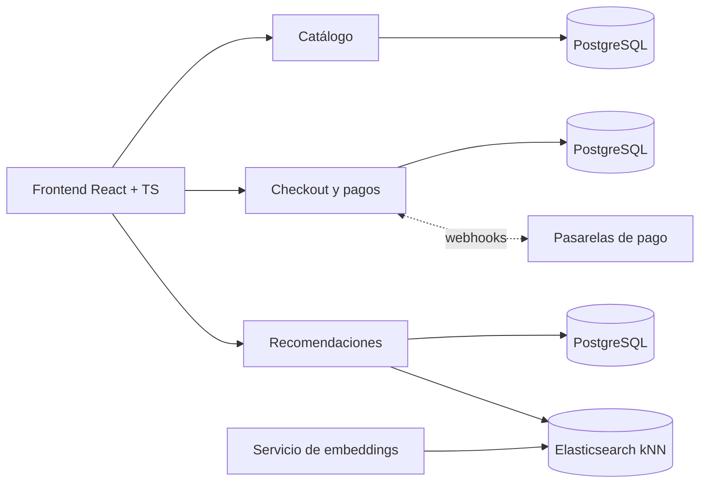

# Arquitectura de CompraPues (vista simplificada)

Diagrama enfocado en los servicios relevantes para las decisiones documentadas. El sistema completo tiene 11 microservicios.

## Principios

| Principio | Cómo se aplica |
|---|---|
| Una base por servicio | Cada microservicio tiene su PostgreSQL, con Row Level Security |
| Aislamiento de carga pesada | Embeddings y kNN fuera del camino crítico de compra |
| Degradar sin romper | Si falla la búsqueda semántica, la compra sigue funcionando |
| Idempotencia en integraciones | Webhooks de pago con firma verificada e ID de evento único |
| Consistencia en escritura | Stock con bloqueo de fila y contadores atómicos |
| Observabilidad | Sentry para errores de producción y endpoint de diagnóstico |
